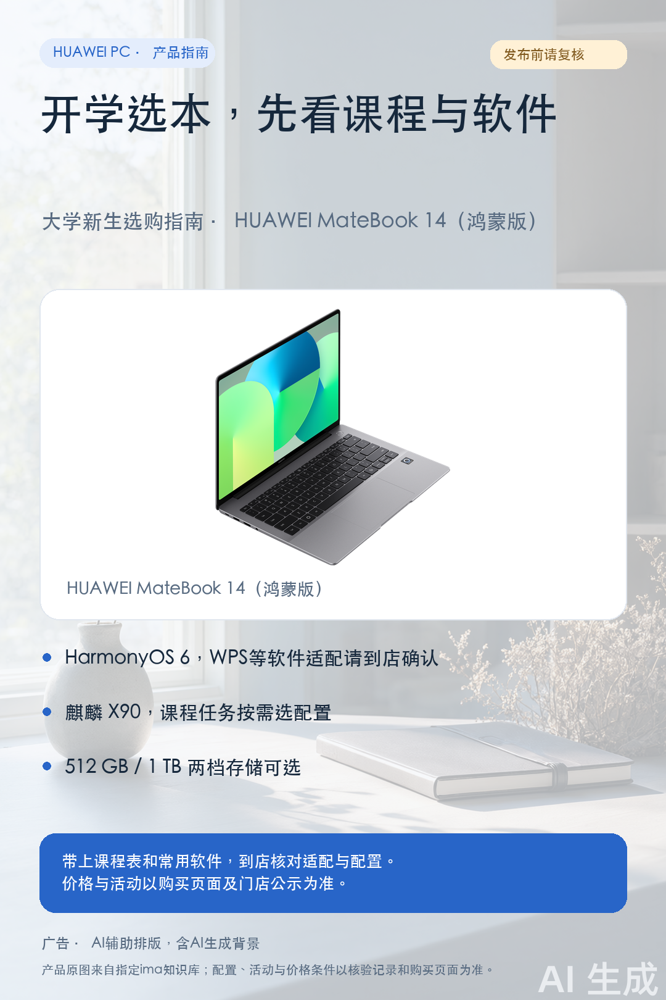
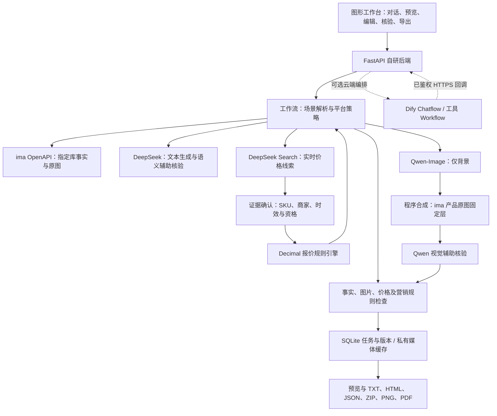

# 华为 PC 图文工作台｜作品说明书

版本：0.1.0 · 记录日期：2026-10-19

本作品面向华为 PC 门店导购和内容运营，帮助操作者把自然语言需求转成有事实依据、有原图来源、可修改和导出的平台内容。ima 作为指定产品知识和原图来源；自研 Agent 负责需求澄清、场景与平台策略、内容组织、报价计算调用及核验。

当前交付包含**已发布的单操作人完整工作台、本地与云端接口实测记录、Dify 接入源码**。官方 API 网关下的业务登录、真实图文生成、修改重开与导出已实测，实际重启后任务与媒体恢复一致。登录修复后，用户实际网页登录确认“已进入工作台”；此项不扩展为全部云端控件已完成浏览器自动化端到端验证。Dify Cloud 尚未联调，原展示案例保留本地来源。

完整应用入口：[华为 PC 图文工作台](https://a1211joy-huawei-pc-agent-app.ms.show) · [魔搭应用空间](https://modelscope.cn/studios/A1211JOY/huawei-pc-agent-app)；云端接口及重启恢复已实测，用户实际网页登录确认通过，登录和使用边界见[完整应用说明](full-app-deployment.md)。另保留[成果展示站](https://a1211joy-huawei-pc-content-studio.ms.show)及其[魔搭展示空间](https://modelscope.cn/studios/A1211JOY/huawei-pc-content-studio)，用于阅读真实案例、下载[说明书 PDF](https://a1211joy-huawei-pc-content-studio.ms.show/docs/manual.pdf)和查看[三分钟演示脚本](https://a1211joy-huawei-pc-content-studio.ms.show/docs/demo-script.html)。GitHub 源码仓库仍待发布，当前没有可提交的仓库链接。统一状态见 [submission-manifest.json](submission-manifest.json)；安装运行以 [README](../README.md) 为准。

## 1. 解决的问题与主要功能

华为 PC 相近型号和系统版本容易混淆，运营内容又需要同时适应不同人群和发布平台。手工查参数、选图、改写、核对和导出的环节分散，价格与优惠还具有时效和资格条件。本作品将这些操作放入“任务与对话—图文创作—依据与核验”的图形工作台。

| 功能 | 操作者如何使用 | 系统如何处理 |
| --- | --- | --- |
| 多轮需求澄清 | 输入产品、人群、场景、平台等自然语言要求 | 信息不足时追问，保存需求卡；允许人工编辑 |
| 场景与购买阶段判断 | 说明面向谁、解决什么问题、处于哪一步选购 | 开学季、职场办公、内容创作、家庭换新、企业采购、门店到访、新品首发、节日营销分别组织切入点 |
| 平台内容转换 | 在公众号、小红书、门店朋友圈、门店海报间切换 | 改变标题、篇幅、结构、语气、配图数量及行动引导 |
| ima 事实与原图检索 | 指定准确产品型号，查看右侧资料及图片 | 读取指定共享库，保留产品型号、原文事实、资料标题、原图来源及插入位置 |
| 文本生成与修改 | 生成、提出修改要求或打开人工编辑器 | DeepSeek 生成与辅助审校，保留版本；保存后可以重新打开，取消不覆盖已保存稿 |
| 联网价格线索与规则计算 | 搜索价格证据，录入具体商家、SKU、条件和时效 | DeepSeek Search 找线索；独立规则引擎计算已核实规则，内容模型只表达结果 |
| 海报合成 | 选择 ima 产品原图并生成背景 | Qwen-Image 仅生成背景，程序将原图按比例作为独立产品层合成，Qwen 视觉模型辅助核验 |
| 核验及交付 | 查看事实、图片、表达、价格和视觉检查项 | 阻断项限制正式复制和成品导出；保留 JSON 或审核报告用于修正 |
| 复制与导出 | 复制成品，选择相应文件格式 | 文章支持 TXT、HTML、JSON、含图片的 ZIP；海报支持 PNG、单页位图 PDF 和审核报告 |

四个平台的内容策略是本项目可配置规则，**不是对平台官方发布规范的完整替代**。本版本的图片数量为：公众号 2–4 张，小红书 3–6 张，门店朋友圈 1–3 张，海报 1 张主视觉。

## 2. 真实运行结果

以下案例来自 2026-10-19 本地程序与真实外部接口的运行产物；不是预先编写后冒充模型输出的演示。文章保留了后续人工标题修改，海报对应同一人群和产品的另一个平台版本。

### 案例 A：大学新生选购的公众号文章

输入条件：大学新生、开学季、比较选型、杭州、用户自述预算 6000 元、HUAWEI MateBook 14（鸿蒙版），关注鸿蒙与 WPS。需求从不完整的“帮我写一篇华为电脑软文”开始，系统追问目标人群与任务后形成需求卡。

生成结果标题为 **《大学新生选笔记本：先看学习任务与携带需求》**，内容围绕携带、屏幕与课程软件适配组织，而非罗列全部参数。成稿引用 4 条 ima 原文事实、配置 3 张已关联型号的原图，并提供来源与插入位置。

> “WPS在鸿蒙上的具体功能完整度、插件兼容性以及专业课程软件（如编程、绘图、统计类工具）是否可用，目前输入资料没有给出明确适配清单，属于待确认信息。”

这段输出展示了证据不足时的处理：保留选购建议，但不把软件适配当作已确认事实。文中的 6000 元明确标注为用户自述预算，没有被转换成产品售价。报价依据为空，因此正文没有生成到手价或优惠承诺。

| 核验项目 | 该次结果 |
| --- | --- |
| 产品事实、图片型号、营销表达规则、模型辅助语义核验 | 通过对应检查 |
| 价格 | 待确认：尚无已核实最低报价 |
| 发布标识 | 待确认：发布时按适用要求完成广告及 AI 内容标识 |

可查看完整的 [文章及四部分报告](../review-site/assets/article-txt.txt)、[结构化结果](../review-site/assets/article-json.json) 和 [含实际配图的 ZIP](../review-site/assets/article-zip.zip)。示例仍属于“待复核草稿”，不能略过发布前复核。

### 案例 B：同一任务转换为门店海报



主标题改为 **“开学选本，先看课程与软件”**；正文压缩为三个短卖点，行动引导改为带课程表和常用软件到店核对。海报不继承公众号的长段落，而是使用一张主视觉。

背景由 `qwen-image-2.1-pro` 实际生成；产品主体来自指定 ima 档案的 HUAWEI MateBook 14（鸿蒙版）原图，由程序按比例贴层，模型不重绘产品。成品保留“广告 · AI 辅助排版，含 AI 生成背景”和“发布前请复核”标识。

本次 `qwen3-vl-plus` 最终视觉核验为 `passed=true`、`issues=[]`；程序还核对渲染输入、文件与原图像素一致性。视觉核验是辅助检查，产品型号由来源记录关联证明，不以“看起来相似”替代型号依据。

可查看 [海报 PDF](../review-site/assets/poster.pdf)、[四部分审核报告](../review-site/assets/poster-audit.txt) 与 [结构化结果](../review-site/assets/poster.json)。该 PDF 为单页位图，不含可独立编辑的文字图层。视觉通过不构成华为官方设计认证。

### 案例 C：联网搜索与确定性报价的分工

真实 DeepSeek Search 调用返回 12 条价格或活动网页线索。系统将其保留为未核实线索，未把搜索摘要自动变成可下单报价。

报价引擎的自动化测试覆盖优惠互斥、门槛与顺序、资格未知、过期、地区、库存、商品成色、服务条件、回收现金与抵扣券等边界。**这些测试使用合成数据，不能作为真实华为价格或活动证据。** 当前案例没有确认杭州最低到手价。

### 新增：云端接口实测

本节来自新部署实例经官方 API 网关实际调用的记录，独立于上述本地案例；没有把本地海报或界面截图改标成云端 UI 截图。

- 平台授权后，无业务 Cookie 的任务读取、创建、设置写入和生成文件请求均返回 401；业务登录及状态接口返回 200。会话 Cookie 实际带 Secure、HttpOnly、SameSite=None、Partitioned，配置为只读，ima 名称为“华为PC知识库1”。
- 真实检索得到 13 条事实，DeepSeek 文章实际引用 4 条，选择 3 张原图。人工修改后标题为“大学新生选电脑：先看课程、携带与软件需求”，重新读取保持一致，复制接口成功。
- 真实 Search 返回 12 条未核实线索；空报价输入没有生成最低价结论。七渠道自动结算价、具体优惠与身份资格仍未确认。
- 云端海报标题为“新生选本，先带课程软件到店核对”，使用 1 张 ima 原图与实际 Qwen-Image 背景。Qwen 视觉返回 `passed=true`、`issues=[]`，程序渲染一致性为 `verified=true`。
- 文章 TXT/HTML/JSON/ZIP，以及海报 PNG/PDF/JSON/审核报告接口均返回 HTTP 200。二进制成品有大小和哈希记录；接口导出成功不表述为浏览器下载、打开及人工视觉检查已经通过。

实际重启并通过接口重新登录后，原任务 revision 15 保留，PNG/PDF 哈希与重启前一致。登录修复后，用户在真实魔搭网页填写凭证并明确确认“已进入工作台”。浏览器确认范围为登录进入，不代表全部云端按钮均已自动化验证。完整哈希、认证结果与证据范围见[完整应用部署说明](full-app-deployment.md)。

### 本次验证范围

- 自动化主测试 192 项、部署启动器 13 项通过，DSL 结构校验通过。测试中的外部调用采用隔离模拟，真实接口运行另有本地与云端接口记录佐证。
- 八类场景 × 四个平台共 32 个规则模式组合无阻断项，验证程序分流与格式边界；不表示已人工评价 32 篇大模型原创内容的营销效果。
- 已实测需求追问、人工改稿及配图说明的保存/取消/重开、报价表单必填与取消恢复、实际剪贴板、文章四格式导出，以及海报 PNG/PDF 导出和 PDF 渲染。
- 四份 Dify DSL 已生成并通过本地结构校验；尚未在用户 Dify Cloud 工作区完成导入和回调验证。

完整记录见 [开发与验收记录](acceptance.md)。

## 3. 架构与业务流程



标准业务链为：场景解析 → 平台策略 → ima 资料与图片检索 → 事实点提取 → 图文编排 → 生成 → 事实与图片核验 → 营销规则检查 → 修改与导出。不同节点各自保留真实状态，连接失败时不假装已完成。

前端采用原生 HTML/CSS/JavaScript，无 Node.js 构建依赖；后端使用 Python 3.11 及以上、FastAPI 和 SQLite。Pillow 负责固定图层与按比例合成。依赖清单位于 `pyproject.toml`，可复现版本与哈希位于 `uv.lock` / `requirements.lock`。

源码中 `workflow.py` 管业务流，`knowledge.py` 管 ima，`policies.py` 管场景与平台，`providers.py` 管模型协议，`pricing.py` 管报价，`validation.py` 管核验，`media.py` 管海报，`exports.py` 管交付，`store.py` 管任务和版本。Dify 导入文件与工具契约独立位于 `dify/`。

## 4. 提示词与核验设计

系统提示词采用稳定约束加任务上下文：先限定角色和证据边界，再输入人群、场景、购买阶段、平台策略、已核实事实、图片索引和报价结果。核心约束包括：

> 产品参数、功能、限制和卖点只能引用输入中 `verified=true` 且绑定型号的 facts；价格只能逐字使用规则引擎的结果和对应条件；从人群的具体问题切入，选择 1 至 3 个相关卖点；软件适配未知时列为待确认；产品主体只能选择已确认型号的 ima 资产。

生成输出固定为 JSON：`title`、`lead`、`body`、`cta`、`tags`、`images`、`fact_ids`。图片项保留资产 ID、说明和位置，`fact_ids` 指向实际使用的事实。程序据此构造统一交付报告，并检查型号、来源、图片数量与价格文字。

生成与审校分开执行。语义辅助审校只检查实际写出的断言，不要求使用全部知识库事实；发现真实阻断问题时至多进行一次自动修复再核验，避免无限循环。模型审校意见仍可能误判，因此只允许基于完整原文与一致字面证据的窄范围复核，不把“模型说通过”视作事实来源。

产品事实和产品原图的唯一生成依据是指定 ima 库；网页搜索用于价格与优惠证据发现，未经确认不能进入确定价格表达。外部资料被视作数据，不能改变任务约束、要求暴露凭证或绕过核验。完整提示词与平台规则可查看 `huawei_agent/policies.py`、`dify/prompts.md` 和 `dify/policy-pack.json`。

## 5. ima 调用方式与事实留痕

系统调用 `https://ima.qq.com/openapi/wiki/v1/{operation}`，在服务端通过 ima 要求的认证请求头携带部署者自己的凭证。凭证内容不进入说明书、前端响应、公开源码或运行示例。

1. `search_knowledge_base` 按“华为PC知识库1”查找共享库，`get_knowledge_base` 再核对名称与可访问性；同名结果不唯一时停止。
2. `get_knowledge_list` 分页遍历获准的产品参数目录，按产品事实档案与图片索引建索引，不将历史营销案例自动升级为产品事实。
3. `get_media_info` 取得资料访问方式，在后端读取原文与图片。临时访问头不转发到任意重定向地址，也不作为公开分享链接。
4. 对照档案中的准确标题、系统和年份消除型号歧义；遇到多个版本不任意挑选。原文按事实段保留必要的配置、测试与使用限制。
5. 图片与型号目录、图片索引共同关联，保存说明、来源及建议插入位置。最终交付只暴露必要的来源记录，不输出完整凭证或私有临时授权信息。

界面可以确认当前工作台登录身份，以及当前 ima 凭证对指定库的连接与权限；现有接口未提供独立账号资料证明，因此**不把操作系统用户名或 Dify 用户标识当作 ima 账号认证**。

目标知识库名为“华为PC知识库1”。部署者需自行取得访问权限。公开展示不附带库权限、私有缓存或凭证。

## 6. 安装、部署与复现

### 本地运行

在源码目录执行：

```sh
sh scripts/start.sh
```

启动脚本优先使用 `uv sync`；没有 uv 时建立 Python 虚拟环境并安装依赖。浏览器访问 `http://127.0.0.1:8787`。macOS 也可双击 `启动工作台.command`。

在“连接与设置”中配置自己的 DeepSeek 与北京地域百炼凭证。当前默认文本模型为 `deepseek-flash`，视觉模型为 `qwen3-vl-plus`，背景模型为 `qwen-image-2.1-pro`；模型权限、可用版本、费用和地域以供应商实际账号为准。DeepSeek Search 复用 DeepSeek 凭证，不必另配 Tavily。

ima 凭证通过部署环境或既有安全配置读取。不得把任何 API Key、Client ID、工具 Token 或登录凭证提交到 Git。详细字段与步骤见 [连接设置](connection-guide.md)。未配置文本模型时可运行明确标记的规则草稿，不能冒充真实模型创作。

### 魔搭完整在线应用

完整工作台已部署为独立 Docker 创空间，服务监听 `0.0.0.0:7860`，模型和 ima 凭证通过平台私有 Secret 注入。官方 API 网关下的业务登录、真实调用、修改重开、导出和实际重启恢复已实测；浏览器登录由用户实际网页登录确认通过。本地界面、云端接口与用户登录确认分别留档，不扩展为全部云端控件的自动化验收。

部署者可在本机发布工具验证授权后复制并自行保存工作台登录名与密码，公开材料不提供实际凭证。此版本使用同一账号的授权操作者共享任务，未实现多人权限和租户隔离。工作台使用会话 Cookie；重启需重新登录，任务及媒体使用 `/mnt/workspace` 下的持久目录。免费 CPU 资源不包含外部模型与搜索费用。具体使用、网关认证、配置和恢复边界见[完整应用部署说明](full-app-deployment.md)。

### Dify 与服务器

1. 先在服务器运行自研后端，并建立真实 HTTPS 地址。业务界面、任务数据库与 Dify 回调须连同一套后端。
2. 若公开工作台，先用 `scripts/configure_access.py` 设置单操作人登录，再配置全站 HTTPS。凭证只在服务器保存；工具 Token 与工作台登录分别管理。魔搭保留 `Authorization` 请求头，工具回调可用后端支持的 `X-Tool-Token`；Dify 回调的两层鉴权仍需单独联调。
3. 向已有 Dify 云端工作区导入 `dify/huawei-pc-chatflow.yml`，配置公共 API 根地址与 Secret 工具 Token，发布应用后在服务端配置该应用的 Service API 凭证。
4. 可选导入 `ima-search-workflow.yml`、`quote-engine-workflow.yml`、`verify-workflow.yml`，或使用 OpenAPI 工具定义。主 Chatflow 通过已鉴权 HTTP 回调调用后端，保留业务任务、用户和任务签名。
5. 从界面发起两轮对话，核对回调、会话、任务版本和失败分支，才能将状态升级为“Dify 云端已验证”。

源码提供 Docker、Compose、Nginx 模板与魔搭部署配置。开发机未执行本地 Docker 构建，魔搭已完成实际云端构建并运行；这不代替最新版本的完整在线验收或 Dify 联调。详见 [Dify 接入](dify-setup.md)、[完整应用部署](full-app-deployment.md)与[服务器选型](cloud-options.md)。

推荐评审复现顺序为：先核对完整应用的实际验收状态并由部署者提供工作台登录 → 在已验收实例复现任务 → 查看公开案例与本文的真实成品 → 按需下载源码本地运行及联调 Dify Cloud。当前云端尚未完成的环节须保留待验收标记。模型调用、搜索和云资源可能产生相应账号费用。

### 检查命令

```sh
.venv/bin/python -m unittest discover -s tests -v
.venv/bin/python dify/validate_delivery.py
```

测试隔离数据库和外部调用，不自动触发付费模型。Dify 校验只验证本地交付结构，不代替工作区导入与公网联调。

## 7. 已知限制与下一步

| 范围 | 当前限制 |
| --- | --- |
| 评审访问 | 完整 Docker 应用已发布，云端接口及重启恢复已实测；用户实际网页登录确认通过，全部云端控件尚未逐一完成浏览器自动化验证；GitHub 源码仓库仍待发布 |
| Dify 云端 | 已有 DSL、工具定义和接入说明，尚待真实导入、发布与双向 HTTPS 回调 |
| 产品覆盖 | 受已接入 ima 档案及凭证权限限制，不代表覆盖全部可售型号与 SKU；软件适配不足时保留待确认 |
| 七渠道报价 | 覆盖目标渠道名称与输入规则；未完成七渠道店铺/小程序/门店自动采集，也未确认杭州最低到手价 |
| 规则能力 | 仅计算契约支持且有证据的顺序与条件；不同补贴基数、跨商品满减、条件返现等需要扩展，不强行解释成最低价 |
| 内容核验 | 规则与模型辅助检查不能保证发现全部问题，不构成法律合规认证、平台审核通过或华为官方认证 |
| 系统规模 | 当前为单操作人及 SQLite 架构，未实现多人权限、租户隔离和多实例生产部署 |
| 公网与运维 | 魔搭已完成云端构建、API 认证/业务、实际重启恢复及用户实际网页登录确认；资源、备份与模型余额仍需维护 |
| 发布 | 当前不自动发布到公众号、小红书、朋友圈或商家账号，由操作者预览、核验后导出 |
| 素材权利 | 产品名称、商标、原图属于相应权利人，附来源用于本作品功能演示；源码的公开不授予第三方素材的再授权 |

后续按实际使用补充云端界面各控件的验证记录，并继续处理 GitHub 源码发布、真实 Dify 云端回调和有来源的具体商家报价；仅按实际证据更新说明书、仓库 README 与展示页。
